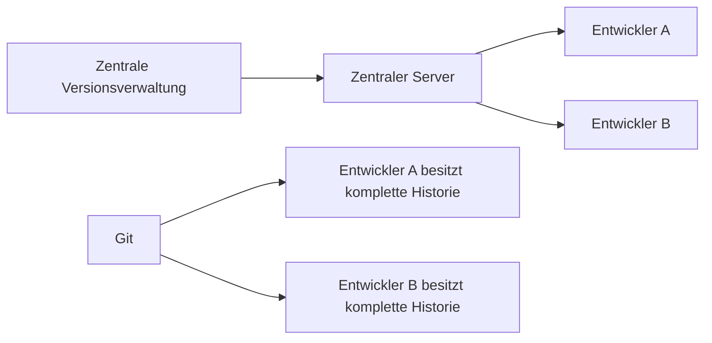
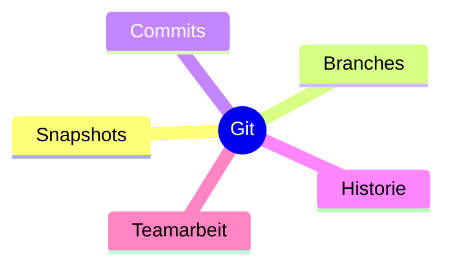
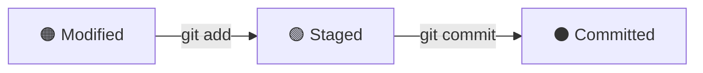
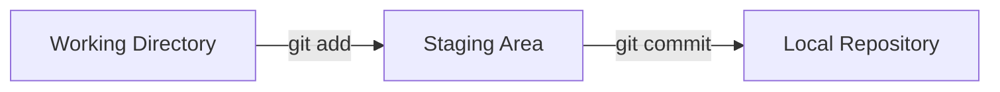
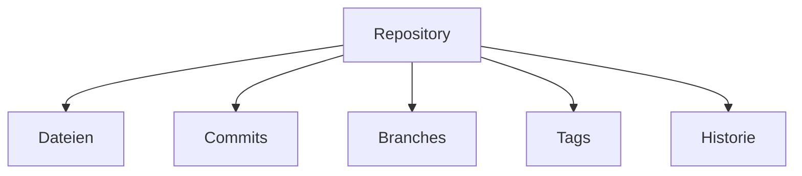
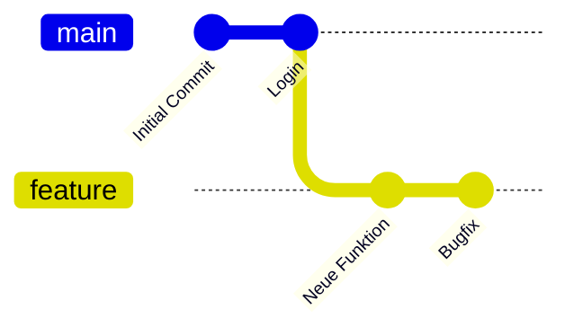
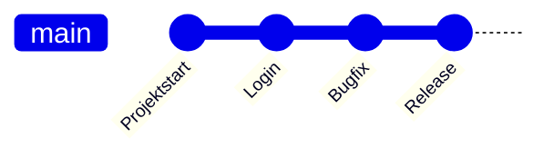

# Git & GitHub Workshop

Willkommen zum Git & GitHub Workshop.

Dieses Repository begleitet die Schulung und dient gleichzeitig als Live-Demo für Git, GitHub und Visual Studio Code.

---

# Agenda

1. Versionsverwaltung
2. Git / GitHub einrichten
3. Git Grundlagen
4. GitHub Grundlagen
5. Entwicklungsumgebungen (VS Code)
6. Learn Git Branching

---

# Versionsverwaltung

Versionsverwaltung speichert Änderungen an Dateien und macht diese nachvollziehbar.

## Vorteile

- Änderungen nachverfolgen
- Frühere Versionen wiederherstellen
- Fehler leichter finden
- Gemeinsam im Team arbeiten
- Konflikte kontrolliert lösen

## Zentral vs. Verteilt



---

# Git Grundlagen

## Was ist Git?

Git ist ein verteiltes Versionsverwaltungssystem, das Änderungen an Dateien und Projekten verfolgt.

### Eigenschaften

- Snapshots statt Änderungen
- Schnell & lokal
- Datenintegrität
- Daten gehen selten verloren



---

# Die drei Zustände einer Datei



### Modified

- Datei wurde geändert

### Staged

- Änderung für den nächsten Commit vorgemerkt

### Committed

- Änderung dauerhaft gespeichert

---

# Git Workflow



---

# Was ist ein Repository?

Ein Repository enthält:

- Projektdateien
- Commits
- Branches
- Tags
- Historie



---

# Was ist ein Branch?

Branches ermöglichen die Entwicklung neuer Funktionen unabhängig vom Hauptzweig.



### Vorteile

- Sichere Entwicklung
- Teamarbeit
- Isolierte Änderungen

---

# Was ist ein Commit?

Ein Commit speichert einen Snapshot des Projekts.



### Commit

- Speichert den aktuellen Projektstand
- Besitzt einen eindeutigen Hash
- Macht Änderungen nachvollziehbar

---

# Was ist .gitignore?

Die Datei `.gitignore` definiert Dateien und Ordner, die Git ignorieren soll.

## Beispiele

```gitignore
*.log
build/
.env
node_modul*s/
```

### Vorteile

- Ver*indert unnötige Commits
* Ver*rauliche Daten bleiben lokal
- Rep*sitory bleibt übersichtlich

---

* Was ist Checkout?

Checkout*we*hselt zwischen Branches.

```merma*d
gitGraph
   *commit
    branch develop
    chec*out develop
    commit
    commit*    checkout main
```

*## Eigenschaften

- Wechselt den a*tuellen Branch
- Aktual*siert die Dateien im Arbeits*erzeichnis
- Off*ne Änderungen sollten*vorher committet werden

---

* Was ist Merge?

Merge führt*Änderungen eines Branches in einen*anderen Branch zusammen.

```merma*d
gitGraph
   commit*id:"Start"

   branch develop
   c*eckout develop
   commit id:"Featu*e"

   checkout main
   commit*id:"Hotfix"

   merge develop
```
*### Eigenschaften

- Änderungen*werden*zusammengeführt
- Git*versucht Konflikte automatisch zu *ösen
- Kann Merge-Konflikte erzeug*n

---

* Was ist Rebase?

Rebase*verschiebt Commits auf die Spitze *ines anderen Branches.

## Vor dem*Rebase

```mer*aid
gitGraph
   commit id:"A"

   *ranch feature
   checkout feature
*  commit id:"B"
   commit*id:"C"

   checkout main
   commit*id:"D"
```

*# Nach dem Rebase

```mer*aid
gitGraph
   commit id:"A"
  *commit id:"D"
  *commit id:"B'"
   commit id:"C'"
`*`

*## Vorteile*
- Saubere Historie
-*Wen*ger Merge-Commits
- Übersichtliche* Verlauf

---

# Was ist ein Merge*Konflikt?

Ein Merge-Konflikt ents*eht, wenn Git Änderungen nicht aut*matisch zusammenführen kann.

```m*rmaid
gitGraph
   commit id:"Hello*World"

   branch branchA
   check*ut branchA
   commit id:"Hello Peo*le"

   checkout main

   branch b*anchB
   checkout branchB
   commi* id:"Hello Friends"
```

### Beisp*el

```text
<<<<<<< HEAD
Hello Peo*le
=======
Hello Friends
>>>>>>> b*anchB
```

---

# Was ist ein Tag?*
Tags markieren wichtige Commits.
*```mermaid
gitGraph
   commit id:"*rojektstart"
   commit*id:"Login"
   commit*id:"v1.0"
   commit id:"Bugfix"
``*

*``bash
git tag v1.0
```

*## Typische Verwendungen

* Releases
- Me*lensteine
- Version*n

*--

# Was ist Git Bisect?

Git Bis*ct hilft dabei, den fehlerverursac*enden Commit zu finden.

```mermai*
flowchart LR
    A*v1.0 GOOD] --> B[Test]
    B -->*C[Test]
    C -->*D[Test]
    D -->*E[First Bad Commit]
```

### Eigen*chaften

- Ver*endet Binärsuche
- Halb*ert den Suchbereich nach*jedem Test
- Spart*Zeit bei der Fehlersuche

---

# G*tHub Grundlagen

## Was ist GitHub*

GitHub*ist eine Cloud-Plattform für Git-R*positories.

### Eigenschaften

- *entrale Speicherung
- Teamarbeit
-*Synchronisation
- Projektverwaltun*

```mermaid
mindmap
  root((GitHu*))
    Re*ositories
    Pull Requests
    Is*ues
    Collaboration
    Cloud
``*

*--

# Was ist ein Remote Repositor*?

Ein Remote*Repository befindet sich auf einem*Server und ermöglicht Zusammenarbe*t.

```mermaid
flowchart LR
    A[*ocal Repository]
    B[GitHub Repo*itory]

    A <-->|Push / Pull| B
*``

---

# Was ist Clone?

Clone e*stellt eine vollständige Kopie ein*s Repositorys.

```mermaid
flowcha*t LR
    A[GitHub Repository]
    *[Local Repository]

    A -->|git *lone| B
```

*``*ash
git clone https://github.com/u*ername/repository.git
```

---

# *ush, Pull & Sync

```mer*aid
flowchart LR
    A*Local Repository]
    B[GitHub Rep*sitory]

    A -->*git push| B
    B -->|git pull| A
*``

*## Push

Änder*ngen hochladen.

### Pull

Änderun*en herunterladen.

### Sync

Be*de Repositorys aktuell halten.

--*

* Was ist ein Pull Request?

Ein Pu*l Request beantragt die Übernahme *on Änderungen.

```mermaid
flowcha*t TD

    A[Feature Branch]
    B[*ommit]
    C[Push]
    D[*ull Request]
    E[Code Review]
  * F[Merge]
    G[main]

    A --> B*    B*--> C
    C --> D
    D --> E
    **--> F
    F --> G
```

### Vorteil*

- Hö*ere Codequalität
- Transparenz
- K*ntrolle vor dem Merge

---

# Was *st ein Fork?

Ein Fork ist eine Ko*ie eines fremden Repositorys.

```*ermaid
flowchart LR
    A[Original Repository]
    B[Eigener Fork]
  * C[Lokales Repository]

    A -->|*ork| B
    B -->|Clone| C
    C --*|Push| B
    B -->|Pull Request| A*```

### Vorteile

- Mitarbeit ohn* Schreibrechte
- Eigene Experiment*
-*Open-*ource-Beiträge

---

# Was sind Is*ues?

Issues helfen*beim Verwalten von Aufgaben und Fe*lern.

```mermaid
flowchart TD

  * A[Issue]
    B[Feature Branch]
  * C[Commit]
    D[*ull Request]
    E[Merge]
    F[*ssue Closed]

    A*--> B
    B --> C
   *C --> D
    D --> E
    E*--> F
```

*## Typische Anwendungsfälle

- Bug*
- Features
-*Verbesserungsvorschläge
-*Aufgabenverwaltung

---

* Entwicklungsumgebungen

Git wird*von vielen Entwicklungs*mgebungen unterstützt:

- VS Code
* Visual Studio
- JetBrains IDEs
- *code

```mer*aid
flowchart TD
    Git*--> VSCode
    Git*--> VisualStudio
   *Git --> JetBrains
    Git*--> Xcode
```

*--

# Warum VS Code*

- Plattformunabhängig
- Kostenlo*
- Sehr gute Git-Integration
- Von*vielen Entwicklern genutzt
- Für*nahezu jede Programmiersprache gee*gnet

---

* Git Workflow in VS Code

```merma*d
flowchart TD

    A*Datei ändern]
    B[Source Control*
    C[Stage Changes]
    D[Commit*
    E[Push]

    A --> B
   *B --> C
    C*--> D
    D --> E
```

*--

# Learn Git*Branching

## Warum Learn Git Bran*hing?

- Keine*Installation erforderlich
- Sofort*ges Feedback
- Git-Befehle werden *isualisiert

```mermaid
flowchart *R
    A*Git Befehl]
    B[Visualisierung]
*   C[Lernen durch Ausprobieren]

 *  A --> B
    B --> C
```

*--

# Vielen Dank

Happy Coding 🚀*
````*
