# Git & GitHub Workshop

Willkommen zum **Git & GitHub Workshop**!

Dieses Repository begleitet die Schulung und dient gleichzeitig als Live-Demo für Git, GitHub und Visual Studio Code.

## Agenda

1. Versionsverwaltung
2. Git und GitHub einrichten
3. Git-Grundlagen
4. GitHub-Grundlagen
5. Entwicklungsumgebungen und Visual Studio Code
6. Learn Git Branching

---

# 1. Versionsverwaltung

Versionsverwaltung speichert Änderungen an Dateien und macht sie nachvollziehbar. Dadurch können frühere Versionen wiederhergestellt und Änderungen zwischen mehreren Entwicklern koordiniert werden.

## Vorteile

- Änderungen nachverfolgen
- Frühere Versionen wiederherstellen
- Fehler leichter finden
- Gemeinsam im Team arbeiten
- Änderungen kontrolliert zusammenführen
- Verschiedene Entwicklungsstände verwalten

## Zentral vs. verteilt

Bei einer zentralen Versionsverwaltung liegt die zentrale Historie auf einem Server. Bei einer verteilten Versionsverwaltung wie Git besitzt jeder Entwickler eine vollständige lokale Repository-Historie.

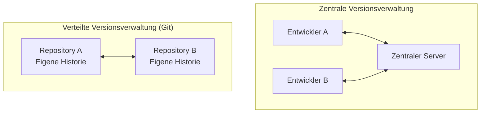

---

# 2. Git-Grundlagen

## Was ist Git?

Git ist ein verteiltes Versionsverwaltungssystem, das Änderungen an Dateien und Projekten verfolgt. Es ermöglicht Entwicklern, Änderungen lokal zu speichern, verschiedene Entwicklungszweige zu erstellen und gemeinsam an Projekten zu arbeiten.

### Eigenschaften

- **Snapshots:** Git speichert Projektstände und verwaltet Änderungen effizient.
- **Schnell und lokal:** Viele Git-Befehle funktionieren ohne Internetverbindung.
- **Datenintegrität:** Git verwendet Hashes, um Inhalte eindeutig zu identifizieren und Veränderungen zu erkennen.
- **Branches:** Verschiedene Funktionen können unabhängig voneinander entwickelt werden.
- **Teamarbeit:** Änderungen können zwischen lokalen und entfernten Repositorys ausgetauscht werden.

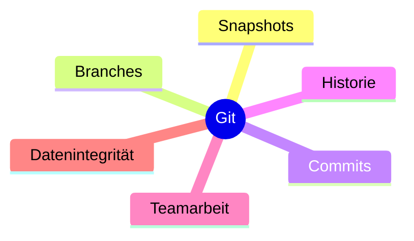

## Die drei Zustände einer Datei

Git unterscheidet drei wichtige Zustände einer Datei:

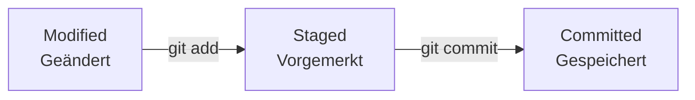

### Modified

Die Datei wurde verändert, aber die Änderungen wurden noch nicht für den nächsten Commit vorgemerkt.

### Staged

Die Änderungen wurden mit `git add` für den nächsten Commit ausgewählt.

### Committed

Die vorgemerkten Änderungen wurden mit `git commit` als neuer Stand in der lokalen Repository-Historie gespeichert.

## Der Git-Workflow

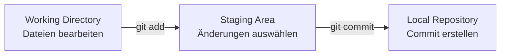

### Wichtige Befehle

```bash
git status
git add datei.txt
git add .
git commit -m "Beschreibung der Änderung"
git log
```

- `git status`: Zeigt den aktuellen Zustand des Repositorys.
- `git add datei.txt`: Nimmt eine bestimmte Datei in die Staging Area auf.
- `git add .`: Nimmt Änderungen im aktuellen Verzeichnis und seinen Unterverzeichnissen auf.
- `git commit -m "..."`: Speichert die vorgemerkten Änderungen als Commit.
- `git log`: Zeigt die Commit-Historie.

## Was ist ein Repository?

Ein Repository ist der Bereich, in dem Git die Projektdateien und ihre Versionsgeschichte verwaltet.

Es enthält unter anderem:

- Projektdateien und deren Versionsstände
- Commits
- Branches
- Tags
- Die Änderungshistorie

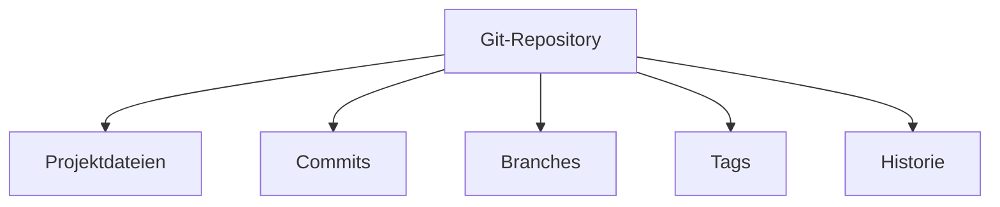

## Was ist ein Branch?

Ein Branch ist ein Entwicklungszweig. Er ermöglicht es, neue Funktionen oder Fehlerkorrekturen unabhängig vom Hauptentwicklungszweig zu bearbeiten.

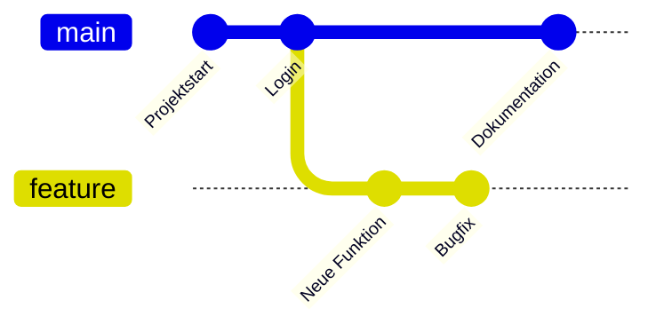

### Vorteile

- Neue Funktionen unabhängig entwickeln
- Änderungen vor der Übernahme testen
- Mehrere Aufgaben parallel bearbeiten
- Zusammenarbeit im Team vereinfachen

### Wichtige Befehle

```bash
git branch
git branch feature
git switch feature
git switch main
```

- `git branch`: Listet lokale Branches auf.
- `git branch feature`: Erstellt einen Branch namens `feature`.
- `git switch feature`: Wechselt zum Branch `feature`.
- `git switch main`: Wechselt zum Branch `main`.

## Was ist ein Commit?

Ein Commit speichert einen bestimmten Projektstand in der lokalen Git-Historie. Er enthält unter anderem Informationen zum gespeicherten Zustand, zum Autor und zum Zeitpunkt der Änderung.

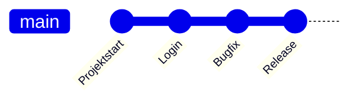

### Eigenschaften

- Speichert den vorgemerkten Projektstand
- Besitzt einen eindeutigen Hash
- Enthält eine Commit-Nachricht
- Macht Änderungen nachvollziehbar
- Baut auf vorherigen Commits auf

### Beispiel

```bash
git add .
git commit -m "Login-Funktion hinzugefügt"
```

**Tipp:** Commit-Nachrichten sollten kurz und aussagekräftig beschreiben, was geändert wurde.

## Was ist `.gitignore`?

Die Datei `.gitignore` legt fest, welche nicht bereits von Git verfolgten Dateien und Ordner ignoriert werden sollen.

### Beispiel

```gitignore
# Logdateien
*.log

# Build-Ausgaben
build/
dist/

# Umgebungsvariablen und Geheimnisse
.env

# Abhängigkeiten von Node.js
node_modules/

# Betriebssystemdateien
.DS_Store
Thumbs.db
```

### Vorteile

- Verhindert unnötige Dateien im Repository
- Hält das Repository übersichtlich
- Verhindert, dass bestimmte lokale Dateien versehentlich neu aufgenommen werden

**Wichtig:** `.gitignore` entfernt keine Dateien, die Git bereits verfolgt. Bereits versionierte Dateien müssen bei Bedarf gesondert aus der Versionsverwaltung entfernt werden. Geheimnisse wie Passwörter oder API-Schlüssel sollten grundsätzlich nicht committet werden.

## Was ist Checkout?

`git checkout` ist ein älterer, vielseitiger Git-Befehl. Er kann unter anderem zwischen Branches wechseln oder bestimmte Dateistände wiederherstellen.

Für das reine Wechseln zwischen Branches wird heute häufig `git switch` verwendet.

### Beispiel

```bash
git switch main
git switch feature
```

Alternativ mit dem älteren Befehl:

```bash
git checkout main
git checkout feature
```

### Eigenschaften

- Wechselt den aktuellen Branch
- Aktualisiert die Dateien im Arbeitsverzeichnis entsprechend dem ausgewählten Stand
- Kann auch zum Wiederherstellen bestimmter Dateistände verwendet werden

**Tipp:** Vor einem Branch-Wechsel sollte man den Zustand der Arbeitsdateien prüfen. Git verhindert in bestimmten Fällen einen Wechsel, wenn lokale Änderungen überschrieben würden.

## Was ist Merge?

Merge führt Änderungen aus einem Branch in einen anderen Branch zusammen.

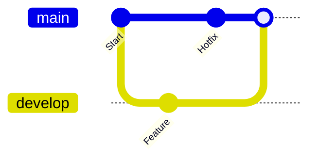

### Eigenschaften

- Führt Entwicklungsstände zusammen
- Bewahrt die ursprünglichen Commits
- Kann einen zusätzlichen Merge-Commit erzeugen
- Kann Merge-Konflikte verursachen

### Beispiel

```bash
git switch main
git merge develop
```

In diesem Beispiel werden die Änderungen aus `develop` in `main` integriert.

## Was ist Rebase?

Rebase setzt Commits eines Branches auf einen anderen Ausgangspunkt. Dadurch kann eine lineare Commit-Historie entstehen.

### Vor dem Rebase

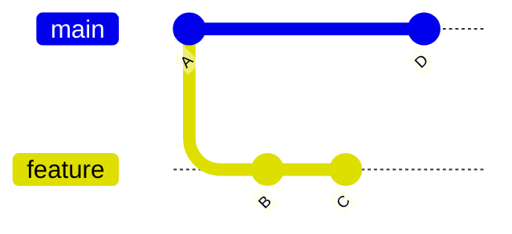

### Nach dem Rebase

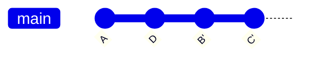

Die Commits `B` und `C` werden beim Rebase auf Grundlage des neuen Ausgangspunkts neu erstellt. Deshalb erhalten sie neue Commit-Hashes.

### Beispiel

```bash
git switch feature
git rebase main
```

### Vorteile

- Kann eine lineare Historie erzeugen
- Vermeidet zusätzliche Merge-Commits in vielen Arbeitsabläufen
- Macht die Entwicklungsgeschichte oft übersichtlicher

**Wichtig:** Rebase verändert die Commit-Historie. Bereits gemeinsam genutzte Commits sollten deshalb nicht ohne Absprache umgeschrieben werden.

## Was ist ein Merge-Konflikt?

Ein Merge-Konflikt entsteht, wenn Git Änderungen nicht automatisch zusammenführen kann. Der Entwickler muss dann entscheiden, welche Inhalte übernommen werden sollen.

### Beispiel

Angenommen, zwei Branches ändern dieselbe Zeile unterschiedlich:

```text
<<<<<<< HEAD
Hello People
=======
Hello Friends
>>>>>>> branchB
```

Die Markierungen zeigen die beiden konkurrierenden Änderungen. Sie sind keine gültigen Bestandteile des endgültigen Dateiinhalts.

### Konflikt lösen

1. Die betroffene Datei öffnen.
2. Entscheiden, welche Änderungen übernommen werden sollen.
3. Die Konfliktmarkierungen entfernen.
4. Die Datei speichern.
5. Die gelöste Datei stagen und den Merge abschließen.

```bash
git status
git add datei.txt
git commit
```

Der letzte Schritt ist bei einem normalen Merge mit Konfliktauflösung üblich. Bei anderen Konfliktsituationen, etwa während eines Rebase, wird der entsprechende Ablauf verwendet.

## Was ist ein Tag?

Tags markieren bestimmte Commits. Sie werden häufig verwendet, um wichtige Versionen eines Projekts zu kennzeichnen.

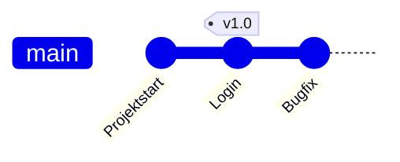

### Beispiel

```bash
git tag v1.0
git tag
```

Um einen Tag auf GitHub verfügbar zu machen:

```bash
git push origin v1.0
```

### Typische Verwendungen

- Releases
- Meilensteine
- Versionsnummern
- Markierung wichtiger Projektstände

## Was ist Git Bisect?

`git bisect` hilft dabei, den Commit zu finden, durch den ein Fehler entstanden ist. Dafür verwendet Git eine binäre Suche: Der zu untersuchende Bereich wird schrittweise verkleinert.

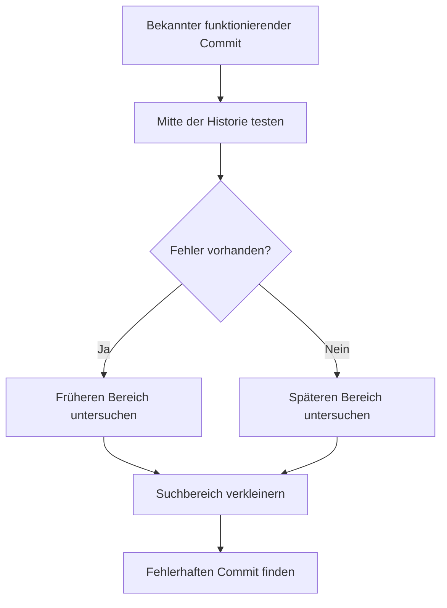

### Beispiel

```bash
git bisect start
git bisect bad
git bisect good <commit-hash>
```

Git wechselt anschließend zu einem zu testenden Commit. Nach jedem Test wird das Ergebnis angegeben:

```bash
git bisect good
```

oder:

```bash
git bisect bad
```

Nach der Suche:

```bash
git bisect reset
```

### Vorteile

- Verwendet eine binäre Suche
- Benötigt bei langen Historien oft deutlich weniger Tests als das manuelle Prüfen jedes Commits
- Unterstützt die gezielte Fehlersuche

---

# 3. GitHub-Grundlagen

## Was ist GitHub?

GitHub ist eine Plattform für das Hosten von Git-Repositorys und die Zusammenarbeit an Softwareprojekten.

### Eigenschaften

- Repositorys online speichern und teilen
- Zusammenarbeit im Team
- Pull Requests und Code Reviews
- Issues zur Aufgabenverwaltung
- Projektorganisation und Automatisierung
- Dokumentation und Veröffentlichung von Software

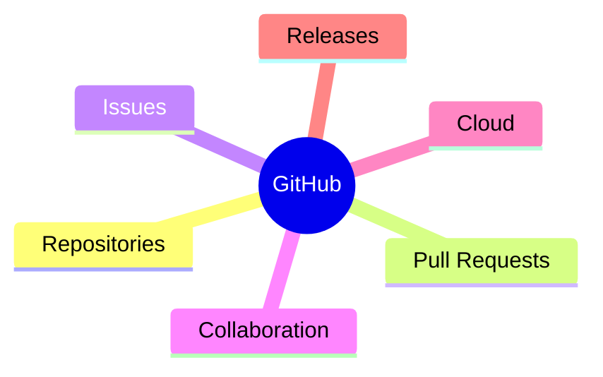

**Unterschied:** Git ist das Versionsverwaltungssystem. GitHub ist eine Plattform, die Git nutzt und zusätzliche Funktionen für die Zusammenarbeit bereitstellt.

## Was ist ein Remote-Repository?

Ein Remote-Repository ist eine entfernte Version eines Git-Repositorys, beispielsweise auf GitHub.

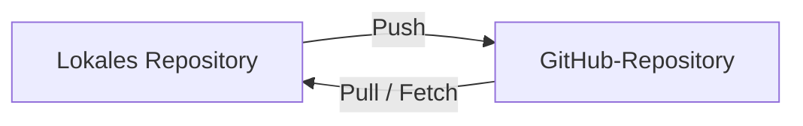

### Wichtige Begriffe

- **Local Repository:** Repository auf dem eigenen Computer
- **Remote Repository:** Repository auf einem entfernten Server
- **Origin:** Häufig verwendeter Name für das Standard-Remote

### Beispiel

```bash
git remote -v
```

Dieser Befehl zeigt die konfigurierten Remote-Verbindungen an.

## Was ist Clone?

Mit `git clone` wird ein bestehendes Repository auf den eigenen Computer kopiert. Dabei werden auch die vorhandene Git-Historie und die Branch-Informationen übernommen.

### Beispiel

```bash
git clone https://github.com/username/repository.git
```

Danach kann das Projekt geöffnet und lokal bearbeitet werden:

```bash
cd repository
git status
```

## Push, Pull und Fetch

Diese Befehle synchronisieren lokale und entfernte Repositorys.

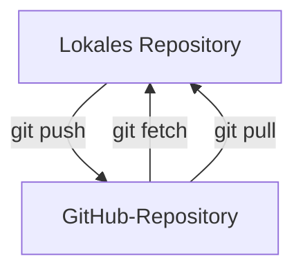

### Push

Lädt lokale Commits zum Remote-Repository hoch.

```bash
git push
```

### Pull

Holt Änderungen aus dem Remote-Repository und integriert sie in den aktuellen lokalen Branch.

```bash
git pull
```

### Fetch

Lädt neue Informationen und Commits vom Remote herunter, ohne sie automatisch in den aktuellen Branch zu integrieren.

```bash
git fetch
```

### Sync

Mit „Sync“ ist allgemein gemeint, dass lokale und entfernte Repositorys aufeinander abgestimmt werden. In Visual Studio Code kann die Synchronisierung beispielsweise das Abrufen und Hochladen von Änderungen umfassen.

## Was ist ein Pull Request?

Ein Pull Request (PR) ist ein Vorschlag, Änderungen aus einem Branch in einen anderen Branch zu übernehmen. Er ermöglicht Diskussionen, Code Reviews und Prüfungen vor dem Merge.

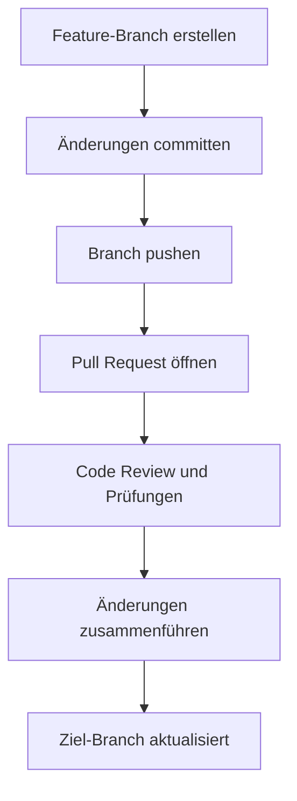

### Vorteile

- Höhere Codequalität
- Nachvollziehbare Änderungen
- Zusammenarbeit und Diskussion
- Fehler können vor dem Merge erkannt werden
- Automatische Tests können eingebunden werden

**Wichtig:** Ein Pull Request ist nicht dasselbe wie ein Commit. Er ist ein Arbeitsablauf zur Überprüfung und Übernahme von Änderungen.

## Was ist ein Fork?

Ein Fork ist eine eigene Kopie eines Repositorys auf GitHub. Er wird häufig verwendet, wenn man an einem fremden Projekt mitarbeiten möchte, aber keine direkten Schreibrechte besitzt.

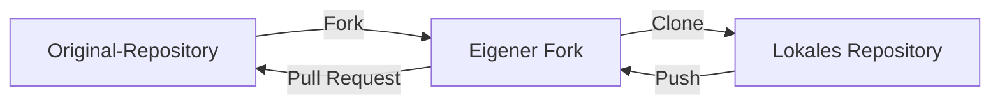

### Vorteile

- Mitarbeit ohne direkte Schreibrechte am Original
- Eigene Experimente
- Beiträge zu Open-Source-Projekten
- Änderungen zunächst unabhängig entwickeln

## Was sind Issues?

Issues dienen dazu, Aufgaben, Fehler und Verbesserungsvorschläge zu dokumentieren und zu verwalten.

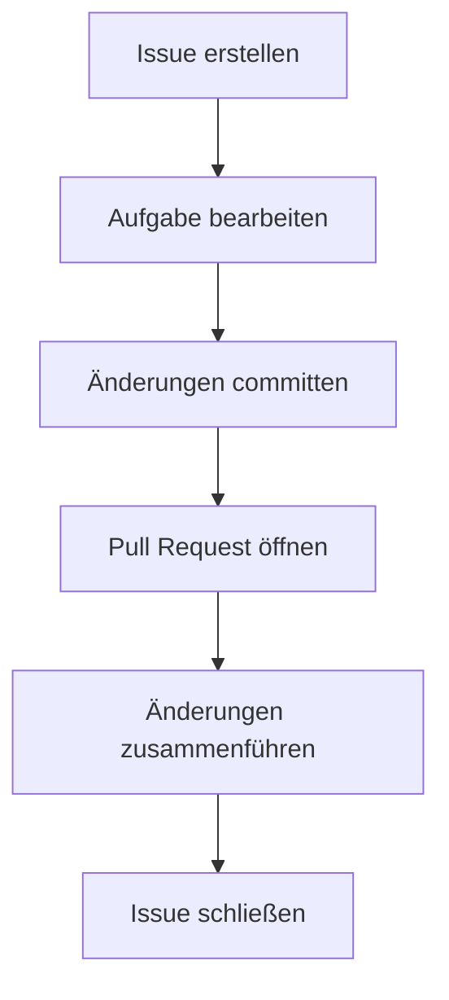

### Typische Anwendungsfälle

- Bugreports
- Neue Funktionen
- Verbesserungsvorschläge
- Aufgabenverwaltung
- Dokumentation von Problemen

---

# 4. Entwicklungsumgebungen

Git wird von vielen Entwicklungsumgebungen unterstützt.

### Beispiele

- Visual Studio Code
- Visual Studio
- JetBrains IDEs, beispielsweise IntelliJ IDEA
- Xcode
- Andere Editoren und Entwicklungswerkzeuge

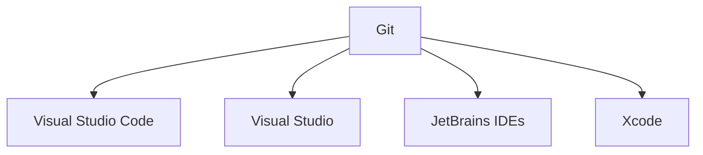

## Warum Visual Studio Code?

- Kostenlos nutzbar
- Plattformübergreifend
- Gute Git-Integration
- Erweiterbar durch Extensions
- Unterstützung vieler Programmiersprachen
- Integriertes Terminal
- Zusammenarbeit über GitHub möglich

## Git-Workflow in VS Code

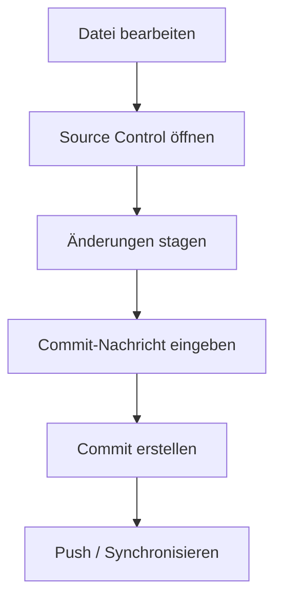

### Typischer Ablauf

1. Projekt in Visual Studio Code öffnen.
2. Dateien bearbeiten.
3. In der Ansicht **Source Control** die Änderungen prüfen.
4. Gewünschte Dateien stagen.
5. Eine aussagekräftige Commit-Nachricht eingeben.
6. Den Commit erstellen.
7. Änderungen zum Remote-Repository pushen.

**Tipp:** Änderungen sollten vor dem Commit geprüft werden. So lassen sich versehentlich hinzugefügte Dateien und unerwünschte Inhalte leichter erkennen.

---

# 5. Learn Git Branching

## Warum Learn Git Branching?

Learn Git Branching ist eine interaktive Lernplattform, auf der Git-Befehle und ihre Auswirkungen auf die Repository-Historie visualisiert werden.

### Vorteile

- Keine lokale Installation erforderlich
- Direktes Feedback
- Visualisierung von Branches und Commits
- Git-Befehle praktisch ausprobieren
- Schrittweises Lernen

```mermaid
flowchart LR
    A["Git-Befehl eingeben"]
    B["Änderungen visualisieren"]
    C["Ergebnis nachvollziehen"]
    D["Weitere Befehle ausprobieren"]

    A --> B
    B --> C
    C --> D
    D --> A
```

## Übung

Versuche, die folgenden Befehle zu verstehen und praktisch anzuwenden:

```bash
git commit
git branch feature
git switch feature
git merge main
git rebase main
```

Achte dabei besonders darauf, wie sich die Commit-Historie verändert.

---

# 6. Vielen Dank!

Vielen Dank für die Teilnahme am Git & GitHub Workshop.

**Happy Coding! 🚀**

Weiterführende Ressourcen:

- [Git – Offizielle Dokumentation](https://git-scm.com/doc)
- [GitHub Docs](https://docs.github.com/)
- [Visual Studio Code – Git](https://code.visualstudio.com/docs/sourcecontrol/overview)
- [Learn Git Branching](https://github.com/pcottle/learnGitBranching)
