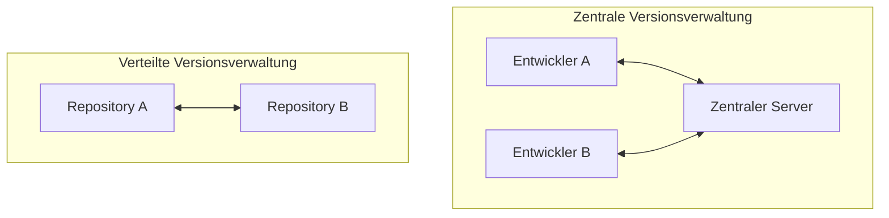
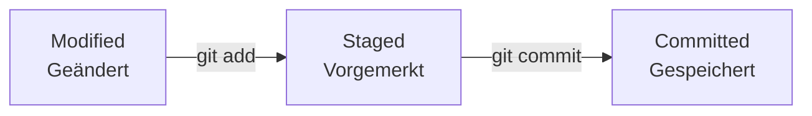
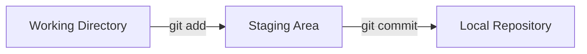
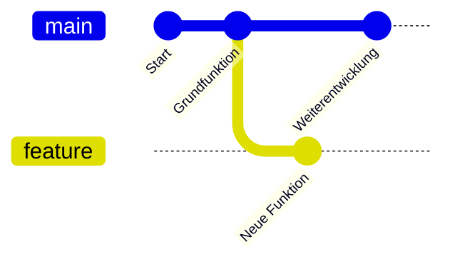
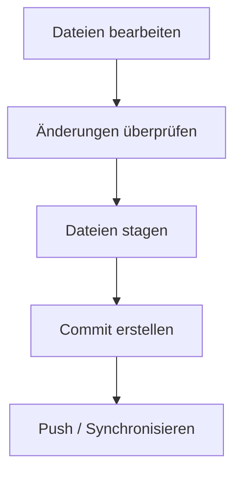

# Git & GitHub Workshop

Willkommen zum **Git & GitHub Workshop**!

Dieses Repository begleitet die Schulung und dient als Nachschlagewerk für die wichtigsten Grundlagen von Git, GitHub und Visual Studio Code.

## Agenda

1. Versionsverwaltung
2. Git und GitHub einrichten
3. Git-Grundlagen
4. GitHub-Grundlagen
5. Entwicklungsumgebungen und Visual Studio Code
6. Learn Git Branching

---

# 1. Versionsverwaltung

Versionsverwaltung dokumentiert Änderungen an Dateien und ermöglicht es, frühere Projektstände nachzuvollziehen oder wiederherzustellen.

## Vorteile

- Änderungen nachverfolgen
- Frühere Versionen wiederherstellen
- Fehler leichter finden
- Gemeinsam im Team arbeiten
- Änderungen kontrolliert zusammenführen

## Zentral vs. verteilt

- **Zentral:** Eine zentrale Stelle verwaltet die Versionsgeschichte.
- **Verteilt:** Jeder Entwickler besitzt eine lokale Kopie der Repository-Historie.

Git ist ein verteiltes Versionsverwaltungssystem.

---

# 2. Git-Grundlagen

## Was ist Git?

Git ist ein verteiltes Versionsverwaltungssystem, das Änderungen an Dateien und Projekten verfolgt.

**Wichtige Eigenschaften:**
- Lokale Versionsverwaltung
- Effiziente Speicherung von Projektständen
- Commits und Branches
- Datenintegrität durch Hashes
- Unterstützung der Teamarbeit

## Die drei Zustände einer Datei

- **Modified:** Eine Datei wurde geändert.
- **Staged:** Änderungen wurden für den nächsten Commit vorgemerkt.
- **Committed:** Änderungen wurden in der lokalen Git-Historie gespeichert.

## Der Git-Workflow

| Begriff | Bedeutung |
|---|---|
| Working Directory | Arbeitsverzeichnis mit den Projektdateien |
| Staging Area | Vorgemerkte Änderungen für den nächsten Commit |
| Local Repository | Lokales Repository mit der Commit-Historie |

## Was ist ein Repository?

Ein Repository verwaltet Projektdateien und deren Versionsgeschichte.

Es enthält unter anderem:
- Commits
- Branches
- Tags
- Historie und Projektstände

## Was ist ein Commit?

Ein Commit speichert einen bestimmten Projektstand in der Git-Historie.

- Besitzt einen eindeutigen Hash
- Enthält Informationen zum Autor und Zeitpunkt
- Besitzt eine Commit-Nachricht
- Baut auf vorherigen Commits auf

## Was ist ein Branch?

Ein Branch ist ein Entwicklungszweig, der unabhängige Änderungen ermöglicht.

- Neue Funktionen getrennt entwickeln
- Fehlerbehebungen unabhängig bearbeiten
- Mehrere Aufgaben parallel bearbeiten
- Änderungen später zusammenführen

## Was ist Checkout?

`git checkout` ist ein Git-Befehl zum Wechseln zwischen Branches und zum Wiederherstellen bestimmter Dateistände.

Für das reine Wechseln zwischen Branches wird häufig `git switch` verwendet.

## Was ist Merge?

Merge führt Änderungen eines Branches in einen anderen Branch zusammen.

- Führt Entwicklungsstände zusammen
- Kann einen Merge-Commit erzeugen
- Kann Merge-Konflikte verursachen

## Was ist Rebase?

Rebase setzt Commits auf einen anderen Ausgangspunkt.

- Kann eine lineare Historie erzeugen
- Kann zusätzliche Merge-Commits vermeiden
- Erstellt beim Umschreiben neue Commits mit neuen Hashes

**Wichtig:** Bereits gemeinsam genutzte Commit-Historien sollten nicht ohne Absprache umgeschrieben werden.

## Was ist ein Merge-Konflikt?

Ein Merge-Konflikt entsteht, wenn Git Änderungen nicht automatisch zusammenführen kann.

- Betroffene Dateien müssen überprüft werden.
- Konfliktmarkierungen müssen aufgelöst werden.
- Die aufgelösten Änderungen müssen anschließend gespeichert werden.

## Was ist `.gitignore`?

Die Datei `.gitignore` legt fest, welche nicht bereits von Git verfolgten Dateien und Ordner ignoriert werden sollen.

Typische Anwendungsfälle:
- Build-Dateien
- Temporäre Dateien
- Logdateien
- Lokale Konfigurationen
- Abhängigkeiten und generierte Dateien

**Wichtig:** Bereits versionierte Dateien werden durch `.gitignore` nicht automatisch aus dem Repository entfernt.

## Was ist ein Tag?

Tags markieren bestimmte Commits und werden häufig für Versionen und Releases verwendet.

- Versionsnummern
- Releases
- Meilensteine
- Wichtige Projektstände

## Was ist Git Bisect?

`git bisect` hilft dabei, den Commit zu finden, durch den ein Fehler entstanden ist.

- Verwendet eine binäre Suche
- Verkleinert den Suchbereich schrittweise
- Erleichtert die Fehlersuche in längeren Commit-Historien

---

# 3. GitHub-Grundlagen

## Was ist GitHub?

GitHub ist eine Plattform zum Hosten von Git-Repositorys und zur Zusammenarbeit an Softwareprojekten.

**Wichtige Funktionen:**
- Repository-Verwaltung
- Pull Requests
- Issues
- Code Reviews
- Teamarbeit
- Releases und Projektverwaltung

**Unterschied:** Git ist das Versionsverwaltungssystem. GitHub ist eine Plattform, die Git nutzt und zusätzliche Funktionen bereitstellt.

## Was ist ein Remote-Repository?

Ein Remote-Repository ist eine entfernte Version eines Repositorys, beispielsweise auf GitHub.

- **Local Repository:** Repository auf dem eigenen Computer
- **Remote Repository:** Repository auf einem entfernten Server
- **Origin:** Häufig verwendeter Name für das Standard-Remote

## Clone, Push, Pull und Fetch

| Begriff | Bedeutung |
|---|---|
| Clone | Erstellt eine lokale Kopie eines Repositorys inklusive Historie |
| Push | Überträgt lokale Commits zum Remote-Repository |
| Pull | Holt Änderungen und integriert sie in den aktuellen Branch |
| Fetch | Holt Änderungen, ohne sie automatisch in den aktuellen Branch zu integrieren |
| Sync | Allgemeine Bezeichnung für die Synchronisierung zwischen lokalen und entfernten Repositorys |

## Was ist ein Pull Request?

Ein Pull Request ist ein Vorschlag, Änderungen aus einem Branch in einen anderen zu übernehmen.

- Code Reviews ermöglichen
- Änderungen diskutieren
- Qualität prüfen
- Änderungen kontrolliert zusammenführen

## Was ist ein Fork?

Ein Fork ist eine eigene Kopie eines Repositorys auf GitHub.

- Mitarbeit an fremden Projekten
- Entwicklung ohne direkte Schreibrechte am Original
- Eigene Änderungen unabhängig bearbeiten
- Beiträge über Pull Requests vorschlagen

## Was sind Issues?

Issues dienen zur Verwaltung und Dokumentation von Aufgaben.

Typische Anwendungsfälle:
- Fehlerberichte
- Neue Funktionen
- Verbesserungsvorschläge
- Aufgabenverwaltung
- Dokumentation von Problemen

---

# 4. Entwicklungsumgebungen

Git wird von vielen Entwicklungsumgebungen unterstützt, darunter:

- Visual Studio Code
- Visual Studio
- JetBrains IDEs
- Xcode

## Warum Visual Studio Code?

- Kostenlos nutzbar
- Plattformübergreifend
- Integrierte Git-Unterstützung
- Erweiterbar durch Extensions
- Integriertes Terminal
- Unterstützung zahlreicher Programmiersprachen

## Git in VS Code

Die Source-Control-Ansicht ermöglicht es, Änderungen zu überprüfen, Dateien zu stagen, Commits zu erstellen und Änderungen mit einem Remote-Repository zu synchronisieren.

---

# 5. Learn Git Branching

Learn Git Branching ist eine interaktive Lernplattform zur Visualisierung von Git-Befehlen und Commit-Historien.

**Vorteile:**
- Keine lokale Installation erforderlich
- Interaktive Übungen
- Visuelle Darstellung von Branches und Commits
- Direktes Feedback
- Praktisches Lernen

---

# 6. Weiterführende Ressourcen

- [Git – Offizielle Dokumentation](https://git-scm.com/doc)
- [GitHub Docs](https://docs.github.com/)
- [Visual Studio Code – Git](https://code.visualstudio.com/docs/sourcecontrol/overview)
- [Learn Git Branching](https://learngitbranching.js.org/)

---

**Vielen Dank für die Teilnahme am Workshop!**

Happy Coding! 🚀
